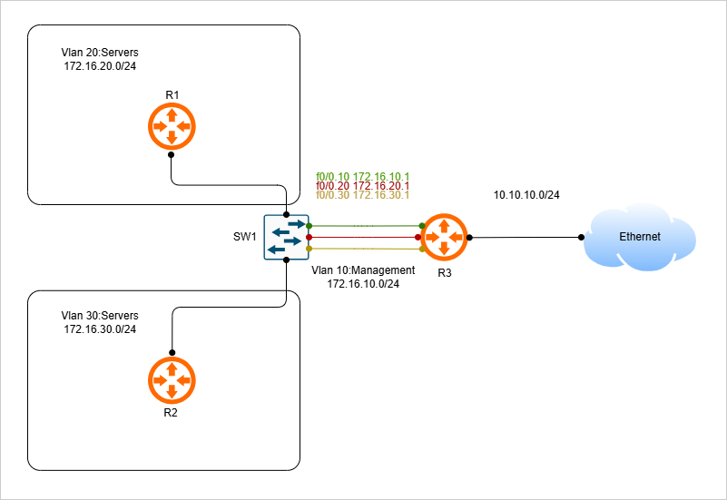
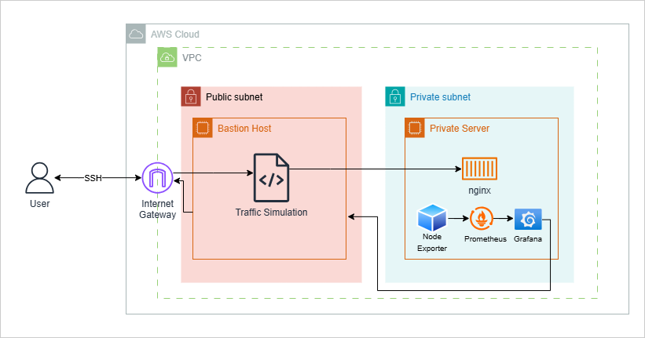

# home-system-boogie

This project is designed to practice my networking and cloud knowledge by creating an at home virtual lab, post passing my CCNA exam and studying for AWS SAA-C03. Concepts used in this project include network and cloud architecture, automation, and monitoring. home-system-boogie will be split into two different phases, highlighting automation in networks simulated in gns3 and monitoring cloud behavior in aws. This project aims to answer the problem of how to host your own simulated network (AWS and GNS3), create network automation scripts (Netmiko), and monitor the system's behavior (Grafana and Prometheus)

#### Tools used:
* GNS3
* Netmiko
* AWS - EC2, VPC
* Terraform
* Prometheus
* Grafana
* Docker

### Phases
Phase 1: Creating a network

* Setup github repository to track progress of the project and documentation.
* Setup network topology in GNS3. Devices in GNS3 should have the ability to be connected to via SSH so configuration can happen from local PC.
* Confirm connection from GNS3 domain to network on local PC using ping and SSH.
* Use Netmiko to Write automation script to create configuration tasks like VLAN setup, interface setup, etc.

Phase 2: Cloud Networking and monitoring
* Setup cloud infrastructure using Terraform including internet gateway, private server, public server, vpc
* Establish docker containers on private server for prometheus, grafana, and node exporter connection
* Create faux traffic to run on bastion host in public subnet. This will be scraped by Prometheus.
* Create panels in Grafana using prometheus as a data source with queries that display metrics like CPU usage, memory usage, network traffic
* After 5 days, observe results and document findings

#### Diagrams
Network Architecture (phase 1)

Cloud Architecture (phase 2)

### Results
CPU usage: 

Values fluctuated between 1% and 1.15% with a noticeable spike at 17:30 UTC (10:30 AM PDT) daily, reaching 1.3% of CPU usage. Using the journalctl command on the EC2 instance, I was able to find: "Jun 26 17:30:01 ip-10-0-2-215.ec2.internal CROND[14983]: (root) CMD (/usr/lib64/sa/sa1 1 1)". This is the "System Activity Reporter", part of the sysstat package (Linux monitoring utility) that runs on a cron schedule to collect system performance data.

Memory Usage:

Values fluctuated between 51.15% and 51.6% usage. Resources taking up this usage include node-exporter, nginx, OS, Grafana, and Prometheus. The EC2 instance is t2.micro, which comes with 1GB of RAM, so about 500MB was being occupied by everything running on it (node-exporter, OS, Grafana, nginx, Prometheus). Likely the most hungry application is prometheus, which keeps recent data in memory before writing to disk.

Network Input:

output had two distinct values: 42.07 and 42.31 bytes per second. Network input represents traffic coming into the private instance. The baseline of 42.07 bytes/sec reflects the consistent stream of HTTP requests arriving from the traffic simulation script running on the bastion host. The periodic spikes to 42.31 bytes/sec likely reflects AWS internal health checks or scheduled Docker/OS maintenance tasks running on that interval.

Network Output:

Values fluctuated between 788.6 and 790.2 bytes per sec. These values most likely come from the responses from nginx.

Overall: Determining whether the infrastructure performed well or not, we have to revisit a few values. For memory, even though it was able to handle all 4 Docker containers at around 51% of capacity, this wouldn't allow for adequate expansion in the future, at least without scaling the instance. The most significant finding however was the CPU spike — monitoring revealed a daily anomaly at 17:30 UTC that was traced via system logs to a scheduled Linux process (/usr/lib64/sa/sa1), the System Activity Reporter from the sysstat package. This demonstrates the core value of monitoring: without Prometheus and Grafana running continuously, this pattern would have gone unnoticed and could have been mistaken for an application issue in a more complex environment.

### How to run

Phase 1:

In a GNS3 new project, follow the topology from diagram 1. Keep in mind you'll have to obtain images from Cisco or another source for the routers and switch, which honestly, setting this up was the biggest hurdle of phase 1 and these two setup items took several days alone. After that, it is simply creating the configuration scripts and having successful SSH connections. SSH will also have to be configured on the devices before attempting to connect to them using the automation script. You can find the switch and router config files in the phase1-gns3 folder. In the environment of your choosing, run router_config.py and switch_config.py from the phase1-gns3 folder. And bam, you just configured cisco devices via SSH using a Python script with a Netmiko library.

Phase 2:

1. You will need a few prerequisites including an AWS account, Terraform, and AWS CLI installed.. In my case for AWS resources, I opted for the free resources as much as I could but wound up spending about $10 in resources for the EC2 instances, the VPC, and the internet gateway.
2. Create your terraform file with the following resources (see main.tf):
   
* VPC with CIDR 10.0.0.0/16, DNS hostnames enabled
* Public subnet 10.0.1.0/24 in us-east-1a
* Private subnet 10.0.2.0/24 in us-east-1a
* Internet Gateway attached to VPC
* Public route table with default route to internet gateway
* Route table association for public subnet
* Security group for bastion (SSH from anywhere on port 22)
* Security group for private instance (SSH from bastion only + Grafana + Prometheus allowed ingress)
* NAT Gateway with Elastic IP (later removed to save costs)
* Private route table pointing to NAT Gateway
* SSH key pair using locally generated RSA key
* Bastion EC2 instance (t2.micro, Amazon Linux 2, public subnet)
* Private EC2 instance (t2.micro, Amazon Linux 2, private subnet)

When you're done, run 'terraform plan' to confirm the resources and then 'terraform apply' to launch.

3. Create SSH keys on your terminal and then confirm SSH into the bastion host on the public subnet. Then confirm SSH connection into private instance. Verify access to internet with pings to a website (ie: www.google.com)

4. While connected to private instance, download Docker and Docker Compose. See docker-compose.yml file for nginx, Grafana, Prometheus, node-exporter services setup. Run docker-compose up -d command to start the containers.

5. On the bastion host in the public subnet, create traffic.sh. Run with 'nohup' so script continues running even after being disconnected from SSH.

6. Setup Grafana: Run SSH tunnel to start up grafana. Once running, open http://127.0.0.1:3000 in your browser. Add Prometheus as a data source (http://prometheus:9090). Create the dashboard and add the 4 panels, each with its own queries to show the metrics that will be monitored over the course of a week. You can find the queries used in the troubleshooting.txt file.

*Here is the point where you can destroy your NAT gateway by removing it from your terraform file, since the cost is approximately $1 per day and we want to eliminate unnecessary AWS costs as much as possible*

7. Allow time to pass (For this project, it was 5 days) to gather data on the system's behavior while traffic.sh runs.

8. To maintain lowest cost, destroy all AWS resources.

